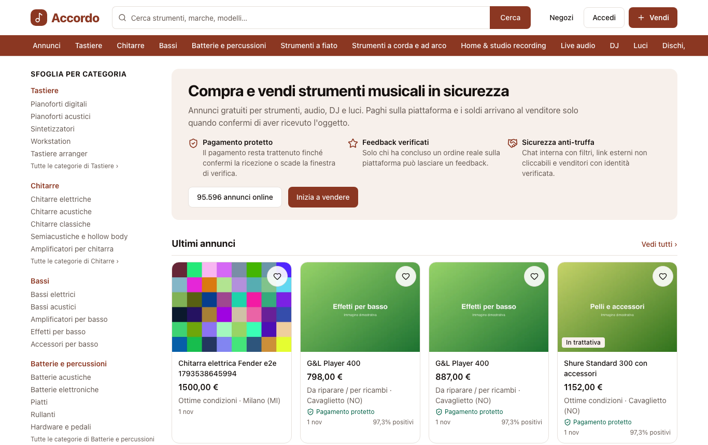
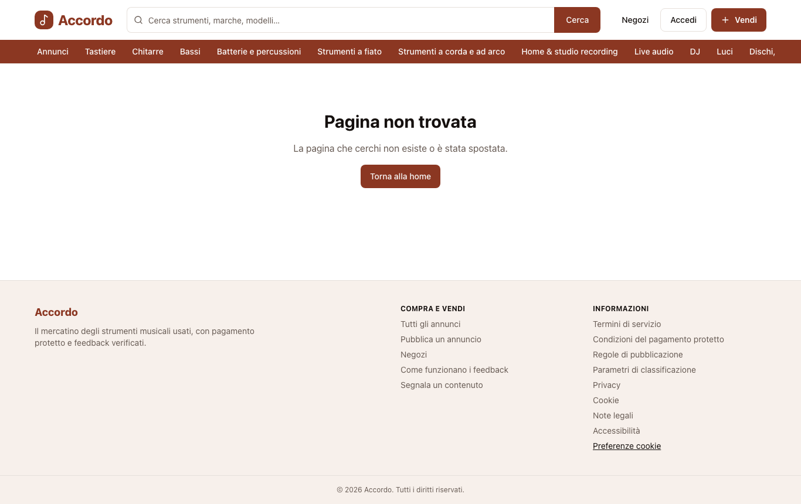
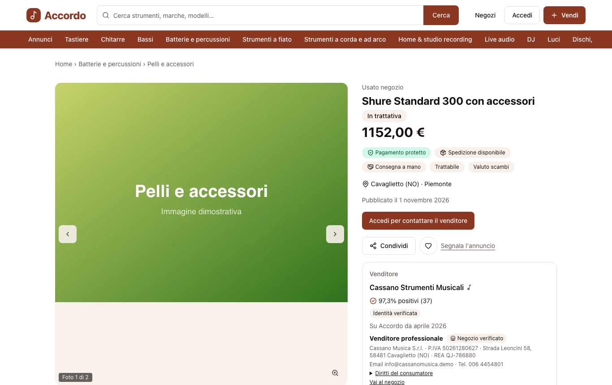
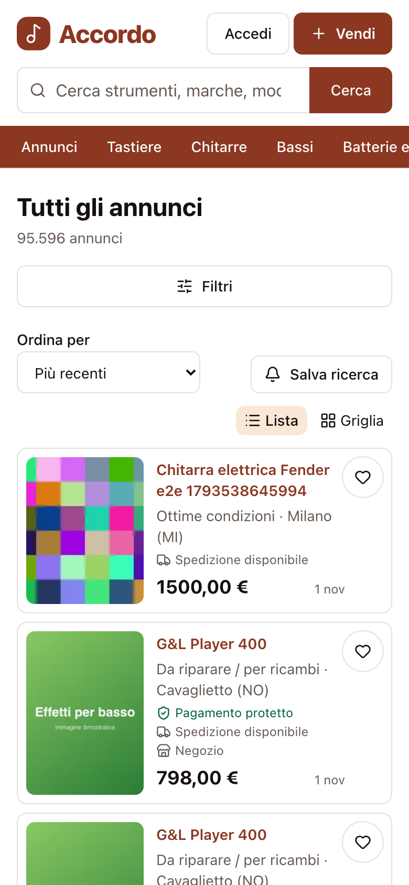

# Accordo

**Il marketplace italiano degli strumenti musicali usati: compri e vendi con pagamento protetto, spedizione integrata e feedback verificati.**

Accordo tiene la semplicità di un portale di annunci (pubblichi gratis, cerchi per categoria, contatti il venditore) e aggiunge le garanzie che lì mancano. Paghi sulla piattaforma e il venditore riceve i soldi solo quando confermi di aver ricevuto lo strumento.

| Home                                                                         | Ricerca                                                                          |
| ---------------------------------------------------------------------------- | -------------------------------------------------------------------------------- |
|             |  |
| **Annuncio**                                                                 | **Mobile**                                                                       |
|  |       |

<sub>Dati demo generati per lo sviluppo: persone, negozi e partite IVA sono inventati.</sub>

## Perché

Nell'usato musicale si paga ancora con bonifici a sconosciuti, ci sono truffe con finti corrieri e recensioni impossibili da verificare. Accordo risolve proprio questo:

- **Pagamento protetto.** I fondi passano da Stripe Connect e il trasferimento al venditore parte solo a ricezione confermata o alla scadenza della finestra di verifica.
- **Spedizione integrata** (Sendcloud) con etichetta e tracking, oppure **consegna a mano** confermata con un codice di 6 cifre.
- **Feedback verificati.** Può lasciarli solo chi ha concluso un ordine reale.
- **Chat anti-truffa.**
  - Link esterni non cliccabili.
  - Telefoni, email e IBAN mascherati, con un avviso.
  - Limiti per gli account nuovi.
- **Controversie con regole chiare.**
  - Tempi definiti per entrambe le parti.
  - Rimborso totale, parziale o con reso.
  - Ricorso esaminato da un altro membro dello staff.

## Funzionalità

**Per chi compra**
- Ricerca istantanea (Meilisearch):
  - tolleranza agli errori di battitura;
  - suggerimenti per marche, categorie e modelli.
- Navigazione da portale:
  - barra dei reparti e albero delle categorie;
  - risultati in lista compatta o in griglia.
- Filtri:
  - categoria, marca, prezzo, anno, condizioni;
  - regione o distanza da un comune;
  - privato o negozio, spedizione, pagamento protetto;
  - caratteristiche tecniche per ogni categoria.
- Ricerche salvate con notifiche, preferiti, venditori seguiti, annunci visti di recente.
- Offerte e controproposte in chat; il prezzo concordato passa direttamente al checkout.

**Per chi vende**
- Pubblicazione gratuita con una procedura guidata:
  - foto ottimizzate automaticamente;
  - attributi specifici per ogni tipo di strumento;
  - bozza salvata.
- Gestione di annunci, vendite e incassi, con stato dell'ordine e scadenze di spedizione.
- **Negozi:**
  - vetrina con i dati legali e l'etichetta "Venditore professionale";
  - politica di resi e garanzia;
  - prezzo più basso degli ultimi 30 giorni accanto ai ribassi (direttiva Omnibus).

**Sicurezza dell'account**
- 2FA (TOTP) e passkey.
- Email di accesso da un nuovo dispositivo con il link "Non sono stato io", che blocca subito l'account.
- Conferma dell'identità prima delle azioni sensibili.
- Limiti contro brute force e spam, con Turnstile.

**Backoffice**
- Moderazione degli annunci con controlli automatici:
  - parole vietate;
  - prezzi anomali;
  - foto riutilizzate.
- Segnalazioni DSA con decisione motivata e ricorso.
- Sanzioni agli account.
- Ordini, rimborsi, controversie e chargeback.
- Impostazioni di commissioni e politiche.
- Impersonificazione in sola lettura, sempre registrata nell'audit.

## Conformità (Italia/UE)

- **GDPR:**
  - export dei dati;
  - cancellazione con anonimizzazione;
  - conservazione dei dati automatica.
- **Cookie:** banner secondo le linee guida del Garante (Accetta e Rifiuta equivalenti, consensi registrati).
- **DSA:**
  - segnalazioni anche anonime;
  - tracciabilità dei venditori professionali;
  - parametri di classificazione pubblici.
- **DAC7:** dati fiscali cifrati, soglie, solleciti, export.
- **Accessibilità:** WCAG 2.2 AA, controllata con axe nei test end-to-end.

I testi legali sono segnaposto **da validare con avvocato e commercialista** (vedi [`docs/COMPLIANCE.md`](docs/COMPLIANCE.md)).

## Architettura

```text
            Caddy (HTTPS)
           /             \
   apps/web               apps/api ──── PostgreSQL 18 (Prisma 7)
   Next.js 16             NestJS 12  ── Valkey (cache, rate limit, code)
   next-intl              Better Auth ─ Meilisearch (ricerca)
                              │      ── S3 / RustFS (foto, etichette)
                         apps/worker
                         BullMQ: pagamenti, email, foto, timer degli ordini, conformità
```

| Area         | Stack                                                                                            |
| ------------ | ------------------------------------------------------------------------------------------------ |
| Frontend     | Next.js 16 (App Router, RSC), React, Tailwind 4, next-intl (italiano e inglese), PWA             |
| API          | NestJS 12, Better Auth, contratti Zod condivisi con l'SDK                                        |
| Dominio      | pacchetto TypeScript puro: macchina a stati degli ordini, importi, contabilità in partita doppia |
| Dati         | PostgreSQL 18, Valkey, Meilisearch, storage S3-compatibile                                       |
| Integrazioni | Stripe Connect, Sendcloud, entrambi con adapter simulati per sviluppo e test                     |
| Qualità      | Vitest, Testcontainers, Playwright con axe, k6, Biome, Turborepo                                 |
| Deploy       | Docker multi-stage, Caddy, GitHub Actions (CI, CodeQL, staging), Renovate                        |

## Qualità e prestazioni

- **Test:**
  - logica di dominio con copertura ≥ 95%;
  - test di integrazione su un database reale (100 test);
  - percorsi utente end-to-end J1–J8 con controlli di accessibilità (zero violazioni gravi).
- **Prestazioni:**
  - ricerca a **200 richieste/s con p95 di 18 ms** su circa 96.000 annunci;
  - pagina annuncio con **LCP di 0,64 s** e 176 KB di JavaScript su rete mobile simulata.
- **Sicurezza:**
  - CSP con nonce;
  - dati fiscali cifrati (AES-256-GCM);
  - audit log non modificabile (ruoli database separati);
  - webhook firmati;
  - gitleaks e CodeQL in CI.

  Dettagli in [`docs/SECURITY.md`](docs/SECURITY.md).

## Stato del progetto

MVP completo: 12 fasi, vedi [`docs/PROGRESS.md`](docs/PROGRESS.md). Prima del lancio servono gli account Stripe e Sendcloud reali, il dominio, la revisione legale e fiscale e un penetration test: la lista completa è in [Prima del lancio](#prima-del-lancio).

## Requisiti

Node.js 26 (`.nvmrc`; consigliato [fnm](https://github.com/Schniz/fnm)), pnpm 12, Docker.

## Avvio da una macchina pulita

```bash
fnm use                    # Node 26
cp .env.example .env       # poi: ENCRYPTION_KEY=$(openssl rand -base64 32)
pnpm install
pnpm infra:up              # PostgreSQL, Valkey, Meilisearch, RustFS (S3), Mailpit
pnpm db:reset              # database da zero: migrazioni + seed (distrugge i dati locali)
pnpm db:seed:demo          # utenti, annunci e ordini demo (solo sviluppo; idempotente)
pnpm search:reindex        # indici di ricerca
pnpm dev                   # web :3000, API :4000, worker (serve anche per elaborare le foto)
```

Su un database già esistente bastano `pnpm db:deploy && pnpm db:seed`. Per gli e2e serve una volta `pnpm exec playwright install chromium`.

| Servizio       | URL                                                |
| -------------- | -------------------------------------------------- |
| Web            | http://localhost:3000                              |
| API readiness  | http://localhost:4000/health/ready                 |
| Bull Board     | http://localhost:4000/admin/queues (staff con 2FA) |
| Mailpit        | http://localhost:8025                              |
| Meilisearch    | http://localhost:7700                              |
| RustFS console | http://localhost:9001 (accordo / accordo-secret)   |

## Comandi

```bash
pnpm lint                  # Biome
pnpm typecheck
pnpm test                  # Vitest (packages/domain con soglia di copertura 95%)
pnpm test:integration      # Testcontainers: richiede Docker
pnpm test:e2e              # Playwright J1–J8 + axe (richiede infra:up; avvia o riusa pnpm dev)
pnpm build
pnpm search:reindex        # ricostruisce gli indici Meilisearch (indice nuovo + scambio atomico)
pnpm db:seed:big           # 100.000 annunci per i test di prestazioni (poi search:reindex)
pnpm search:bench          # p50/p95 della ricerca
pnpm perf:budget           # LCP, CLS e JS della pagina annuncio su una build di produzione
pnpm load:test             # k6 in Docker: ricerca 200 req/s, pagina annuncio 100 req/s
pnpm infra:down
```

Gli e2e riusano `pnpm dev` se è già avviato: in quel caso avvialo con `RATE_LIMIT_ENABLED=false NEXT_PUBLIC_ANALYTICS_SRC=http://localhost:3000/analytics-test.js pnpm dev`. Per prestazioni e carico vedi `docs/RUNBOOK.md` ("Prestazioni e carico").

## Dati demo (solo sviluppo)

- **Contenuto:** 60 utenti, 2.000 annunci e ordini in ogni stato.
- **Utenti:** `admin@accordo.local`, `moderatore@accordo.local`, `supporto@accordo.local`, `negozio@accordo.local`, `utente@accordo.local`, …; password di tutti `accordo-demo-2026`.
- **Backoffice** (`/admin`): richiede ruolo staff e 2FA. Lo staff demo ha il segreto TOTP di sviluppo `accordo-demo-totp-secret-2026-xx`; in un'app di autenticazione va inserito in base32: `MFRWG33SMRXS2ZDFNVXS25DPORYC243FMNZGK5BNGIYDENRNPB4A`.
- **Pagamenti:**
  - `PAYMENT_PROVIDER=fake` (predefinito): il checkout mostra "Paga (simulazione)";
  - `stripe`: servono le chiavi test e `pnpm stripe:listen`.
- **Spedizioni:**
  - `SHIPPING_PROVIDER=mock` (predefinito): le etichette sono PDF di prova e gli eventi del corriere si simulano dalla pagina dell'ordine;
  - `sendcloud`: servono le chiavi dell'integrazione.
- **Codice di consegna a mano** degli ordini demo: `123456`.

## Produzione

Immagini Docker multi-stage (`Dockerfile`, target `web`, `api`, `worker`, `migrate`) e compose di esempio per una VM, con Caddy (TLS automatico), backup giornaliero e ruoli database separati:

```bash
cp infra/compose/prod.env.example infra/compose/.env.prod     # segreti nuovi: openssl rand -base64 32
docker compose -f infra/compose/docker-compose.prod.example.yml --env-file infra/compose/.env.prod up -d --build
# https://accordo.localhost (CA locale di Caddy), API su https://api.accordo.localhost
```

Il servizio `migrate` applica le migrazioni e il seed di base prima dell'avvio di API e worker. Deploy su staging: `.github/workflows/deploy-staging.yml`. Procedure operative (deploy, rollback, backup e ripristino, incidenti, rotazione delle chiavi, data breach): [`docs/RUNBOOK.md`](docs/RUNBOOK.md).

## Documentazione

| File                                           | Contenuto                                      |
| ---------------------------------------------- | ---------------------------------------------- |
| [`docs/ARCHITECTURE.md`](docs/ARCHITECTURE.md) | componenti, flussi, diagrammi                  |
| [`docs/DECISIONS.md`](docs/DECISIONS.md)       | ADR                                            |
| [`docs/PAYMENTS.md`](docs/PAYMENTS.md)         | pagamento protetto, ledger, politiche          |
| [`docs/FEEDBACK.md`](docs/FEEDBACK.md)         | regole di feedback e reputazione               |
| [`docs/SECURITY.md`](docs/SECURITY.md)         | threat model e checklist                       |
| [`docs/COMPLIANCE.md`](docs/COMPLIANCE.md)     | stato delle voci normative (da validare)       |
| [`docs/RUNBOOK.md`](docs/RUNBOOK.md)           | operazioni e incidenti                         |
| [`docs/DATA_SOURCES.md`](docs/DATA_SOURCES.md) | fonti dei dati (ISTAT CC BY 4.0, Wikidata CC0) |
| [`docs/PROGRESS.md`](docs/PROGRESS.md)         | avanzamento per fasi                           |

## Prima del lancio

- [ ] Stripe:
  - attivare l'account live e fare approvare il modello di business (fondi trattenuti fino alla conferma di ricezione);
  - provare l'adapter con le chiavi test (Accounts v2, 3DS, trasferimenti, chargeback);
  - configurare le regole Radar (`docs/SECURITY.md`).
- [ ] Sendcloud: firmare il contratto, provare l'adapter in sandbox (metodi, pesi, resi), configurare i webhook.
- [ ] Dominio e DNS: record per web, API e storage; email con SPF, DKIM e DMARC; provider SMTP transazionale.
- [ ] Revisione dell'avvocato: termini, privacy, cookie, condizioni del pagamento protetto, regole di pubblicazione, dichiarazione di accessibilità, testi DSA.
- [ ] Revisione del commercialista: IVA sulla commissione, DAC7 (corrispettivo, tracciato AdE, blocco degli incassi), conservazione dei dati.
- [ ] DPA firmati con Stripe, il provider di spedizioni, l'hosting, il provider email, Cloudflare (Turnstile) e lo strumento di analytics.
- [ ] Banner cookie configurato con lo strumento di analytics scelto (Plausible o Umami nell'UE).
- [ ] Turnstile con chiavi reali; `RATE_LIMIT_ENABLED=true`.
- [ ] Backup:
  - PITR attivo;
  - copia giornaliera su storage separato;
  - versioning dei bucket;
  - **primo test di ripristino eseguito e registrato** nel RUNBOOK.
- [ ] Penetration test esterno; supporto a più chiavi in `ENCRYPTION_KEY` prima della prima rotazione.
- [ ] Verifica manuale dell'accessibilità con tecnologie assistive.
