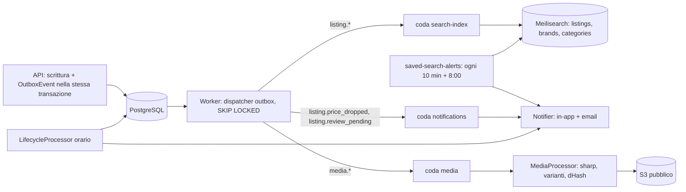
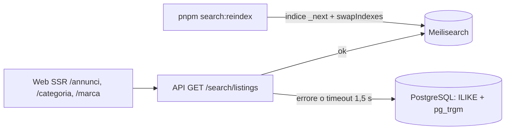
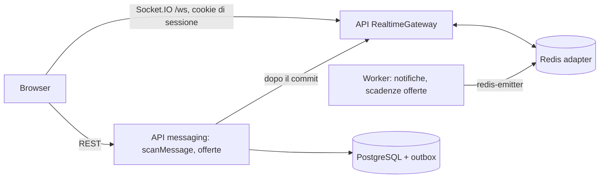

# Architettura

Panoramica completa: SPEC.md §5. Stato attuale (Fase 0):

- `apps/web` — Next.js 16 (App Router), next-intl (`it` predefinito senza prefisso, `en` sotto `/en`), Tailwind 4, token shadcn/ui da `@accordo/ui/styles.css`.
- `apps/api` — NestJS 12 (Express, ESM). `ConfigModule` (env validato con Zod), `PlatformModule` (health, filtro Problem Details, bootstrap bucket in sviluppo). Prefisso REST `/api/v1`; health su `/health/live` e `/health/ready`.
- `apps/worker` — NestJS standalone + BullMQ; job ricorrente `heartbeat`.
- `packages/*` — librerie TypeScript compilate in `dist/` con `tsc`; Turborepo compila le dipendenze prima di `dev`, `typecheck`, `test`, `build`.

- `packages/search` — impostazioni Meilisearch, documento, traduzione dei parametri, reindicizzazione (usato da API, worker e `scripts/`).

## Flusso degli eventi (Fasi 3–4)



## Ricerca (Fase 4)



## Messaggi e realtime (Fase 5)



## Ordini e pagamenti (Fase 6)

```mermaid
flowchart LR
  W[Web checkout] -- POST /orders + Idempotency-Key --> API
  API -- PaymentIntent --> P[PaymentProvider: fake | stripe]
  P -- webhook firmato --> API
  API -- WebhookEvent + outbox --> PG[(PostgreSQL)]
  PG --> WK[Worker coda payments]
  WK -- applyOrderEvent --> PG
  WK -- transfer source_transaction / refund --> P
  SW[Sweeper ogni minuto] -- applyOrderEvent --> PG
  N[Controlli notturni: ledger, fondi trattenuti] --> PG
```
